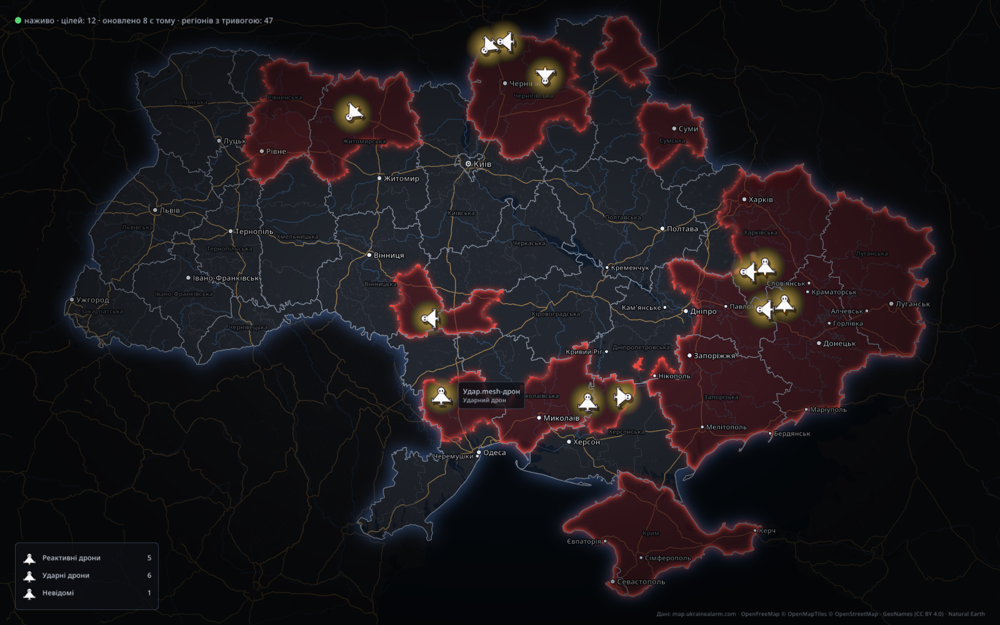

# alarmmap

A desktop map of air raid alerts and aerial targets over Ukraine, updated live.



alarmmap draws the data of [map.ukrainealarm.com](https://map.ukrainealarm.com)
in a native window: regions under alert, drones, missiles, guided bombs and
other targets with their heat trails, over an OpenFreeMap basemap with place
names.

> **Not an official alert source.** alarmmap is an independent project, not
> affiliated with Ukraine Alarm. Data can be delayed or incomplete. For your
> safety, rely on official alerts.

## Features

- Regions under alert, with a pulse when an alert has just started.
- Targets by kind (attack and jet drones, cruise and ballistic missiles,
  guided bombs, aircraft and others) that glide between position reports.
- Heat trails of target movement, as on the site.
- Hover over a target to see its name and the dashed path it has flown since
  the program started.
- New targets arrive with a teleport animation; lost targets vanish in an
  explosion that leaves a fading scorch mark. An explosion means the target
  dropped out of the feed, not that it was shot down.
- Summary of current targets by kind.

## Install

Download the AppImage from the
[latest release](https://github.com/ashevchuk/alarmmap/releases/latest) and run it:

```sh
chmod +x alarmmap-*-x86_64.AppImage
./alarmmap-*-x86_64.AppImage
```

The AppImage runs on x86-64 Linux with glibc 2.35 or newer (Ubuntu 22.04,
Debian 12, Fedora 36 and later) and an X11 or XWayland session.

## Controls

| Input | Action |
| --- | --- |
| Mouse wheel | Zoom at the cursor |
| Left button drag | Pan |
| `+` / `-` | Zoom at the centre |
| `0`, `Home`, `R` | Show the whole country |
| Hover over a target | Show its name and path |

## Build from source

Requirements: CMake 3.24 or newer, a C++20 compiler, libcurl 8.11 or newer
with WebSocket support and raylib 6. nlohmann/json and earcut are fetched by
CMake.

```sh
cmake -S . -B build -DCMAKE_BUILD_TYPE=Release
cmake --build build -j
ctest --test-dir build
./build/alarmmap
```

`cmake --install build` installs the program, its data, a desktop entry and
an icon.

Command line options:

```text
alarmmap [--targets FILE] [--alerts FILE] [--screenshot PNG] [--benchmark FRAMES]
alarmmap --version
```

- `--targets`, `--alerts`: show saved snapshots instead of the live feed.
- `--screenshot`: render one frame into a PNG file and exit.
- `--benchmark`: render frames without a frame rate cap and print the average
  frame time.

Region geometry and basemap tiles are cached in `$XDG_CACHE_HOME/alarmmap`
(by default `~/.cache/alarmmap`).

## Data and credits

- Alerts and targets: [map.ukrainealarm.com](https://map.ukrainealarm.com).
- Basemap: [OpenFreeMap](https://openfreemap.org), © OpenMapTiles,
  © OpenStreetMap contributors.
- Place names: [GeoNames](https://www.geonames.org), CC BY 4.0.
- Crimea outline: [Natural Earth](https://www.naturalearthdata.com), public domain.
- The AppImage bundles the Noto Sans font, SIL Open Font License 1.1.

## License

MIT, see [LICENSE](LICENSE).
